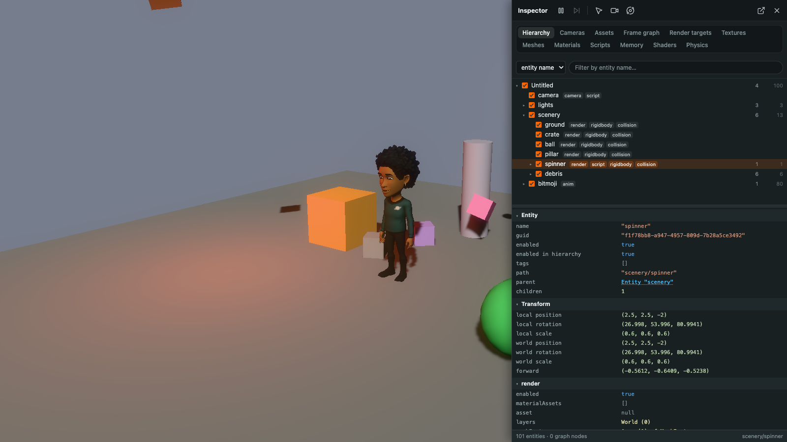
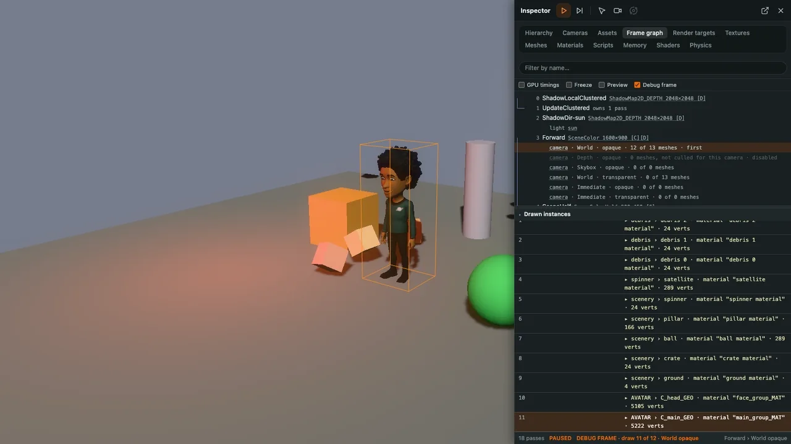

# PlayCanvas Inspector

[](https://www.npmjs.com/package/@playcanvas/inspector)
[](https://npmtrends.com/@playcanvas/inspector)
[](https://github.com/playcanvas/inspector/blob/main/LICENSE)
[](https://discord.gg/RSaMRzg)
[](https://www.reddit.com/r/PlayCanvas)
[](https://x.com/intent/follow?screen_name=playcanvas)

| [User Manual](https://developer.playcanvas.com) | [Blog](https://blog.playcanvas.com) | [Forum](https://forum.playcanvas.com) |

A debug panel for running [PlayCanvas](https://github.com/playcanvas/engine) apps. It shows the entity
hierarchy and every component's properties, and tabs for the cameras, assets, frame graph,
performance, render targets, textures, meshes, materials, scripts, memory, shaders and physics of
the app, with live previews of textures and render targets, picking and flying in the view, and a
debug frame mode that steps through the draw calls of a render pass.

The inspector is read-only, apart from toggling entities on and off, pausing and stepping the app,
and view-only overrides (render modes, wireframe, a flown or orbited camera) it removes when it
closes.



## Install

```sh
npm install @playcanvas/inspector
```

It requires PlayCanvas Engine 2.23 or newer. `playcanvas` is a peer dependency: the inspector works
on your app's own engine, so it must be the same `playcanvas` package your app imports.

TypeScript declarations are included, generated from the JSDoc of the sources.

## Use

```javascript
import { Inspector } from '@playcanvas/inspector';

const inspector = new Inspector(app, { dock: 'left', width: 480 });
```

Press <kbd>`</kbd> to show or hide the panel, <kbd>F9</kbd> to pause and <kbd>F10</kbd> to step a
frame while paused. The keys, dock side, width and more are options of the constructor.

Or, from the Editor or a scripted scene, as a script on an entity:

```javascript
import { EntityInspector } from '@playcanvas/inspector';

const entity = new Entity('inspector');
entity.addComponent('script');
entity.script.create(EntityInspector, { properties: { dock: 'left' } });
app.root.addChild(entity);
```

### Step through a frame

In the Frame graph tab, select a forward pass or one of its layer steps and turn on **Debug frame**.
The app pauses and the pass draws only up to the selected draw; the arrow keys step through the
draws one at a time, with each one outlined in the view and listed with its mesh and material. It
needs the debug build of the engine.



### Record performance

On the Performance tab, press the record button (a ring around a dot) to capture every frame, up to
the last 1000; it shows red while recording, and pressing it again stops. The button beside it
clears the capture. Charts cover
the whole capture: the frame interval, the CPU time on the main thread by phase, the GPU time and
the draw calls by kind. Below them, the Memory chart draws the JavaScript heap, the video memory and
each kind of it as lines sharing a scale, and the Resources chart the count of textures, render
targets, shaders, buffers and pipelines; untick a line in the list beside a chart to hide it, and
the chart rescales to the others. The Events section has a row, which can be unticked too, for each
kind of event, marking the frames that had one: hitches (frames taking over twice the median), long
animation frames, shaders compiled, garbage collections, resources created or destroyed, assets
loaded and the app's own measures. Click the name of a chart or a section to collapse it. Hover a
mark for what happened, or a chart for the figures of the frame under the pointer. A dashed line
marks the display interval on the Frame, CPU and GPU charts, which are scaled to show it.

Click a frame, or a mark, to show it on a timeline of its own, and everything recorded for it below:
what held it back, the CPU time by phase, the GPU time of each pass, the work it submitted, memory
and resources, and its events. The timeline is a flame chart: the update, post-update, inspector
and render of the CPU, with the physics step, the animation and the phases of the render under
them, then the GPU passes and the events. With frames selected together, it shows their average
frame. Scroll over the timeline to zoom into part of the frame, drag the scrollbar under it to pan
and double-click it to see the whole frame again. Drag across the charts to select frames together,
with their averages, 95th percentiles and largest figures; scroll to zoom, drag the scrollbar under
the charts to pan and double-click to see the whole capture again. **‹** and **›** step a frame,
**«** shows the first and **»** the newest, following it as frames are recorded. While the panel has
focus, the arrow keys step a frame (ten with <kbd>Shift</kbd>), <kbd>Home</kbd> shows the first and
<kbd>End</kbd> follows the newest.

Turn on **GPU timings** to record the GPU time. An engine whose GPU profiler does not say which
frame its timings belong to, such as 2.23, gets them a few frames late, which the tab notes. The
inspector runs inside the app's update, so its own time is shown apart, as Inspector; turn off
**Inspector time** to leave it out of the CPU chart, which then scales to the app's own time. The
release engine times the update and the render as a whole; the profiler and debug engines add the
phases of the render and the breakdown of the draw calls. Spans the app measures with
`performance.measure` show on the timeline of their frame.

### Edit transforms

Click a position, rotation or the local scale in the Transform section of an entity to edit it as
three numbers separated by commas (one number for a uniform scale); Enter applies it and Escape
gives up. Or turn on **Move**, **Rotate** or **Scale** in the toolbar and drag the handles of the
gizmo drawn on the selected entity. A drag on a handle is kept from the app, while away from the
handles the app has the view as usual. Pick, Fly and Orbit are off while a gizmo is on; Esc or its
button turns it off. An entity with a physics body takes its body along.

### Copy as JSON

Right-click a row, a section title or an item of a list to copy it to the clipboard as JSON, with
numbers at full precision. Right-click the header of a group, such as Textures on the Memory tab,
to copy the group, or the name of a tab to copy everything it lists: the Hierarchy tab copies the
hierarchy from its root. **Copy as JSON** copies it on its own; **Copy N levels deep** also copies
what it links to, such as the children of an entity, its mesh instances, their materials and their
textures, up to N links away; **Copy all levels** follows every link, so copying the root copies
the whole hierarchy. A link that is not followed is named by `$type` and its name or id, and
marked `$stub`; an object already copied elsewhere in the copy is marked `$ref`. A node's parent
and the lists of what uses an object are left out, so a copy never climbs out of what was copied.

On the Performance tab, right-click the name of the tab to copy the whole capture, every frame with
all it recorded, or the name of a chart or section, or a line of its list, to copy that series a row
per frame, as JSON or as CSV for a spreadsheet; both cover the frames selected together when there
are any. Right-click a frame in the charts to copy it, inside the frames selected together to copy
their figures, and the timeline to copy its bars.

## Engine versions

Each inspector release names the engine versions it supports in its `playcanvas` peer dependency.
The inspector reads engine internals to show what it shows, so a new engine release can need a new
inspector release. The range takes later 2.x releases but not prereleases of them, such as
`2.24.0-beta.1`, as npm does not match prereleases of other versions than the range names.

## The devtools hook

From engine 2.23, every PlayCanvas app announces itself to a hook defined on the global object,
which is how the upcoming browser extension finds apps on any page:

```javascript
globalThis[Symbol.for('playcanvas.inspector')] = {
    register(app, { version, revision, protocol }) {},
    unregister(app) {}
};
```

The hook must be defined before the engine creates the app. `register` is called once each app is
initialized, and `unregister` when it is destroyed. `protocol` is `1`.

## Development

Node 22.19 or newer.

```sh
npm install
npm run lint
npm test
npm run build:types # writes the TypeScript declarations to types/
npm run test:types  # compiles a TypeScript usage of the package against them
npm run publint     # checks the package is publishable
```

The tests run against the `playcanvas` version in `devDependencies`, on the engine's null graphics
device under jsdom.

A few engine helpers the inspector draws with are copied into `src/renderers`, `src/picker` and
`src/input`, so the inspector does not depend on them being in the app's engine build. See
[COPIED_FROM.md](COPIED_FROM.md).

## License

MIT
